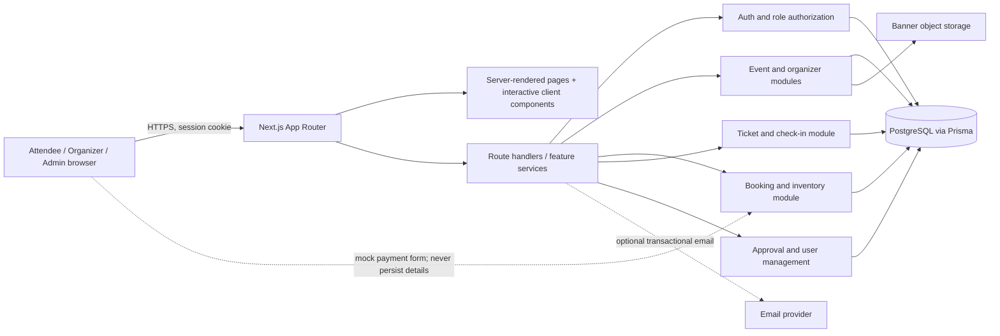

# Architecture

## Trust boundaries

The browser is untrusted. Authentication, role checks, input validation, availability checks, price calculations, hold expiry, payment simulation status, and check-in mutations must be enforced on the server. Store password hashes only. Mock card/UPI inputs must not be logged or stored. QR payloads should carry an opaque ticket public ID, not personal data; the check-in endpoint must perform a conditional one-time status transition.

## Booking inventory transaction

On hold creation, a database transaction must first release expired pending holds for the selected inventory, then conditionally reserve available capacity and create the pending booking with an expiry timestamp. Payment success confirms the booking and creates one ticket per seat in a transaction. Payment failure or expiry releases reserved inventory exactly once. A uniqueness or conditional update must protect check-in from duplicate scans.

The current implementation contains only the public presentation layer. The module/data design above is a target contract, not implemented API behavior.
