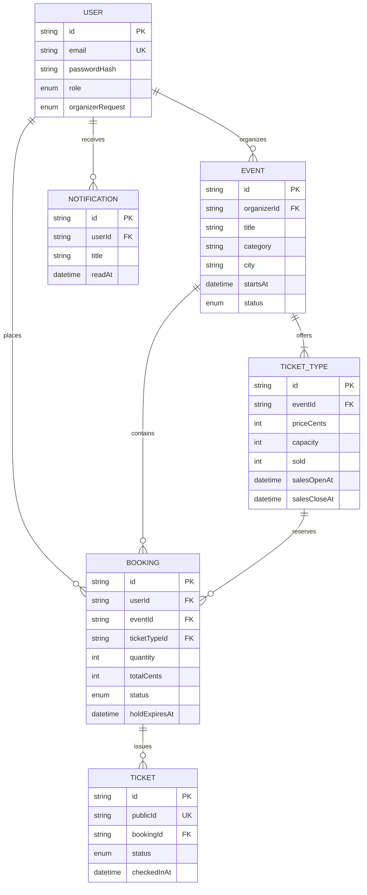

# Data model

The Prisma schema in `prisma/schema.prisma` is the proposed PostgreSQL model. This diagram documents the intended relationships; database migrations and generated Prisma client are not yet available because the package install was interrupted by low disk space.

Payment instrument details are intentionally absent from the schema. Counts and status transitions must be updated transactionally by the server.
